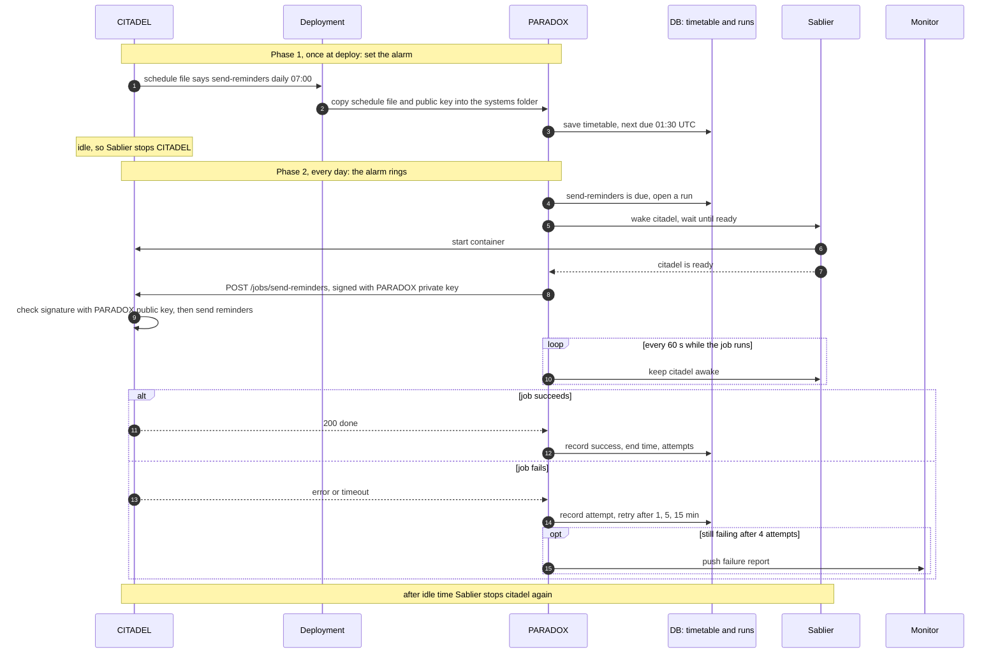
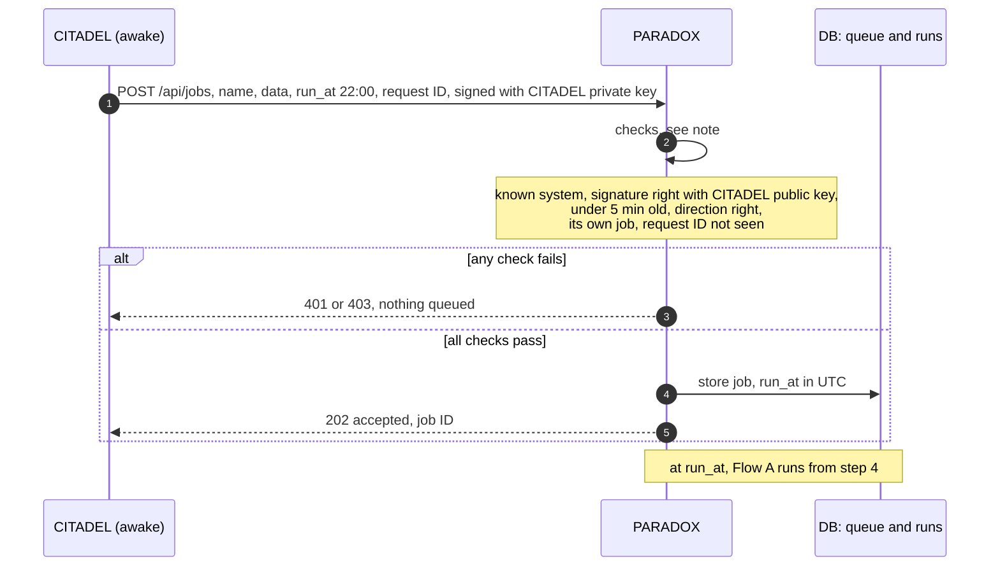

# How PARADOX works

PARADOX is an alarm clock for systems that sleep. A system sets the alarm once, by declaring its jobs in a schedule file. PARADOX rings it on time: it wakes the system, asks it to run the job, retries a failure and reports what still fails. A system that is awake can also queue one of its own jobs for later.

Requirement IDs (PX-...) refer to [prd.md](prd.md). The architecture diagram and link numbers are in the PRD, Annex B.

## The schedule file

Each system has its own subfolder in PARADOX's systems folder (location is a setting), holding `schedules.yaml` and `system.pub` (its public key; two lines while a key is being changed). Draft format; the published contract is the reference.

```yaml
system: citadel
wake: sablier                # or none, for an always-on system
# address: https://...       # only for systems not on the internal network
jobs:
  - name: send-reminders     # CITADEL must answer POST /jobs/send-reminders
    every: "0 7 * * *"       # minute hour day month weekday, in PARADOX's timezone
    timeout: 10m
    retries: 3               # 4 attempts in total
  - name: generate-certificates
    timeout: 30m             # no "every": only run when queued
```

## Flow A: a scheduled job

Example: CITADEL sends learners reminders every day at 07:00 Colombo time (01:30 UTC). CITADEL is asleep at that time.



**Phase 1: CITADEL sets the alarm (once, at deploy)**

1. CITADEL's team writes `send-reminders` into CITADEL's schedule file. The code that sends reminders lives in CITADEL; PARADOX never sees it.
2. At deploy, the deployment repository copies the file and CITADEL's public key into CITADEL's subfolder of PARADOX's systems folder (PX-SCH-01).
3. PARADOX saves the timetable in UTC (PX-SCH-03). From now on CITADEL may sleep.

**Phase 2: the alarm rings (every day)**

4. At 01:30 UTC the job is due and PARADOX opens a run, one record of one attempt (PX-REC-01).
5. PARADOX asks Sablier to wake CITADEL and waits, because a stopped container has no network name to call (PX-RUN-01).
6. Sablier starts CITADEL's container.
7. Sablier answers once CITADEL is ready.
8. PARADOX calls CITADEL's job address, signed with PARADOX's private key (PX-SIG-01).
9. CITADEL checks the signature with PARADOX's public key, so only PARADOX can trigger its jobs, then runs its own code.
10. While the job runs, PARADOX keeps CITADEL awake, so a long job is never cut off (PX-RUN-02).
11. Either CITADEL answers that it is done,
12. and PARADOX records success.
13. Or CITADEL fails or runs out of time,
14. and PARADOX records the attempt and tries again after 1, 5, then 15 minutes (PX-REP-01).
15. If the last attempt also fails, PARADOX reports it once to the monitor, which alerts a person (PX-REP-02).

An outside system is always on: PARADOX skips steps 5 to 7 and 10 for it, and calls it over HTTPS (PX-SYS-03, PX-SYS-04).

## Flow B: a system queues a job

Example: a trainer publishes a course in CITADEL, and CITADEL wants certificates generated tonight at 22:00.



1. CITADEL asks PARADOX to queue `generate-certificates` for 22:00, with the data the job needs (for example the course ID) and a request ID, a unique tag so a repeat is not queued twice (PX-JOB-01, PX-JOB-03). No `run_at` means as soon as possible.
2. PARADOX checks who is asking and whether they may ask for this job (PX-SIG-02 to PX-SIG-04).
3. Either it refuses: an unknown system or a bad signature gets 401, another system's job gets 403, and nothing is queued (PX-SIG-05).
4. Or it accepts and stores the job, converting the time to UTC,
5. and CITADEL gets back a job ID. At 22:00 Flow A takes over from step 4: wake, run, retry, report.

## Who holds which key

| Party | Holds privately | Holds publicly |
|---|---|---|
| PARADOX | its own private key | every system's public key |
| Each system | its own private key | PARADOX's public key |
| Deployment repository | PARADOX's private key | all public keys |

Private keys never leave their owner. Only public halves are exchanged, so an outside team can send theirs by email (PX-SYS-02, PX-NFR-05).
