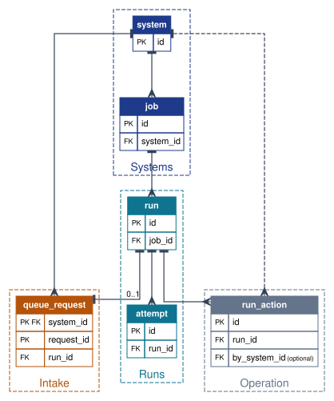
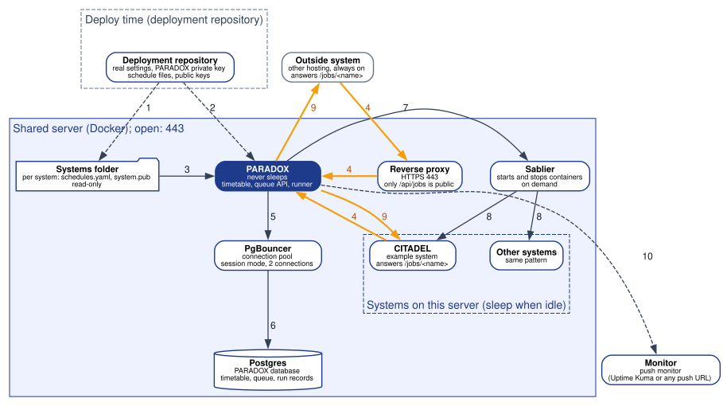

# PARADOX

The scheduler and job queue for systems that sleep when idle.

Version 1.2 (frozen), 31 October 2026. Owner: Suseenthiran Arulraj Rumeasiyan.

## 1. Overview

Systems on a shared server sleep when nobody uses them, to save memory. A sleeping system cannot keep time, so its timed work either keeps it awake or never runs.

PARADOX is one small service that never sleeps and keeps time for every system. It contains:

- a **timetable**, read from one schedule file per system;
- a **queue**, where a system can ask for one of its jobs to run now or at a set time;
- a **runner**, which wakes the system, asks it to do the job, retries failures and reports what still fails;
- a **record** of every run;
- a **published contract** (schedule file format, queue request, signing scheme) and a small helper that systems use to sign and check calls.

How it works end to end: a system's team declares its jobs in a schedule file, for example "send reminders every day at 07:00". At deploy the file and the system's public key are copied into the system's subfolder of PARADOX's systems folder. When a job is due, PARADOX asks the waker to start the system if it is asleep, waits until it is ready, and calls the system's job address with a signed request. The system checks the signature and runs its own code for that job. PARADOX keeps the system awake until the job ends, records the result, retries a failure after a pause, and reports a job that fails every attempt to a monitor. A system that is awake can also queue one of its own jobs, signed with its own key, for PARADOX to run later in the same way. Systems on other hosting are supported; they are called directly and are not woken.

PARADOX is named after Professor Paradox in *Ben 10*, who is never late.

**Not included:** a screen of any kind; the job code itself (it lives in each system); server wiring (deploy entry, database, proxy route, key storage, monitors), which the deployment repository provides; sending messages to people.

Values marked "(default: ...)" are settings the operator may change.

## 2. Stakeholders

| Stakeholder | Role in PARADOX |
|---|---|
| System development teams | **System owners**: write their system's schedule file, build a job address for each job, hold their system's private key and give PARADOX the public half. |
| Platform team | **Operator**: deploys PARADOX, places schedule files and public keys, holds PARADOX's private key, reads the record and retries or cancels jobs from the command line. |
| On-call person | Receives the monitor's alerts when a job fails every attempt or PARADOX stops sending its heartbeat. |
| Teams running systems on other hosting | **System owners** of outside systems: same duties, and their system must stay awake. |
| Open-source users | Run PARADOX on their own servers with their own settings. |

A system is known to PARADOX only through its schedule file and public key (PX-SYS-01). Nobody logs in to PARADOX; the operator works through the command line on the server.

## 3. Functional requirements

### 3.1 Systems (PX-SYS)

| ID | Requirement |
|---|---|
| PX-SYS-01 | PARADOX knows a system only if the systems folder holds a subfolder with a schedule file for it. A system with no file can neither queue jobs nor be called. |
| PX-SYS-02 | Each system has its own key pair. PARADOX holds only the public half of each system's key, plus its own private key. |
| PX-SYS-03 | Each system's schedule file sets whether it is woken before every run or always on (default: woken). Systems on other hosting are always on. |
| PX-SYS-04 | Each system's schedule file may set the address PARADOX calls it on (default: its name on the internal network, port 8080). PARADOX refuses to start if an address outside the internal network is not encrypted. |
| PX-SYS-05 | Changes to systems, schedules or keys take effect when PARADOX restarts. |

### 3.2 Schedules (PX-SCH)

| ID | Requirement |
|---|---|
| PX-SCH-01 | PARADOX reads one read-only folder holding one subfolder per system, each with the system's schedule file and public keys (PX-SYS-02). It never reads any other folder. |
| PX-SCH-02 | Each job in a schedule file has a name, an optional repeating time to the minute (none means the job is only queued, PX-JOB-01), a time limit (default: 10 minutes) and a number of retries (default: 3, so 4 attempts in total). |
| PX-SCH-03 | Times in schedule files are read in one timezone (default: UTC) and stored in UTC. A time skipped or repeated by a daylight-saving change runs once. |
| PX-SCH-04 | An invalid schedule file stops PARADOX from starting and names the file, line and fault. |
| PX-SCH-05 | If PARADOX was down when a job was due, it runs the missed job once on start if it is less than 1 hour late (default), and otherwise records it as missed. |
| PX-SCH-06 | A scheduled job never runs twice at the same time. If its previous run is still going when it is due again, the new run is recorded as skipped. |

### 3.3 Queued jobs (PX-JOB)

| ID | Requirement |
|---|---|
| PX-JOB-01 | A system can queue one of its own jobs with data for the job (maximum 64 KB, default) and an optional start time. No start time, or a time already passed, means as soon as possible. |
| PX-JOB-02 | A start time more than 30 days ahead (default) is refused. |
| PX-JOB-03 | An accepted request returns a job ID. A repeat of the same request ID within 24 hours (default) returns the first job ID and queues nothing new. |
| PX-JOB-04 | A system can ask for the state of its own job by job ID: queued, running, succeeded, failed or cancelled. |
| PX-JOB-05 | A system can cancel its own job while it is still queued. |
| PX-JOB-06 | Queued jobs survive a restart of PARADOX. |

### 3.4 Running jobs (PX-RUN)

| ID | Requirement |
|---|---|
| PX-RUN-01 | Before running a job for a system that is woken (PX-SYS-03), PARADOX asks the waker to start it and waits until it is ready, for up to 2 minutes (default). A wake that runs out of time counts as a failed attempt. |
| PX-RUN-02 | While a job runs, PARADOX keeps its system awake, renewing every 60 seconds (default). |
| PX-RUN-03 | PARADOX calls the system's job address with the job's data, signed (PX-SIG-01). A success answer is success; any other answer, or none within the time limit (PX-SCH-02), is a failed attempt. |
| PX-RUN-04 | PARADOX runs up to 10 jobs at the same time across all systems (default). |
| PX-RUN-05 | On shutdown, PARADOX takes no new runs and waits up to 30 seconds (default) for running ones. Runs still going are retried after restart. |

### 3.5 Signed calls (PX-SIG)

| ID | Requirement |
|---|---|
| PX-SIG-01 | Every call from PARADOX to a system carries a signature over the method, address, time, direction and content, made with PARADOX's private key. |
| PX-SIG-02 | Every request from a system to PARADOX carries the same kind of signature made with that system's private key. PARADOX checks it against the system's public key. |
| PX-SIG-03 | A signature more than 5 minutes old or more than 5 minutes ahead (default) is refused. |
| PX-SIG-04 | A signature made for one direction is refused in the other. |
| PX-SIG-05 | An unknown system or a bad signature is answered "not authenticated"; a job that belongs to another system is answered "not allowed". Nothing is queued and the refusal is logged. |
| PX-SIG-06 | Up to two public keys per system, and up to two PARADOX public keys in the helper (PX-CON-03), are accepted at once, so keys change without downtime. |

### 3.6 Retries and reports (PX-REP)

| ID | Requirement |
|---|---|
| PX-REP-01 | A failed attempt is retried after 1, 5 and then 15 minutes (default), up to the job's retries (PX-SCH-02). |
| PX-REP-02 | A job that fails every attempt is reported once to the monitor, with the system, job, attempts and last error. PARADOX never sends messages to people itself; all alerts go through the monitor. |
| PX-REP-03 | PARADOX sends a heartbeat to the monitor every 60 seconds (default). A missing heartbeat is how the on-call person learns PARADOX is down. |
| PX-REP-04 | PARADOX answers a health check that passes only when it can reach its database. |

### 3.7 Records and operation (PX-REC)

| ID | Requirement |
|---|---|
| PX-REC-01 | Every run is recorded with the system, job, due time, start, end, attempts, result and the last error (first 2 KB). |
| PX-REC-02 | A job's data is deleted when the job ends. Run records are deleted after 90 days (default). |
| PX-REC-03 | The operator can list runs by system, job, result and date from the command line. |
| PX-REC-04 | The operator can retry a failed job or cancel a queued job from the command line. Each such action is recorded with the time. |

### 3.8 Contract and helper (PX-CON)

| ID | Requirement |
|---|---|
| PX-CON-01 | PARADOX publishes, versioned in its repository, the schedule file format, the queue request and its answers (PX-JOB-01 to PX-JOB-05), and the signing scheme (PX-SIG-01 to PX-SIG-04). |
| PX-CON-02 | A change that breaks a published version gets a new major version number. |
| PX-CON-03 | A small helper lets a system sign its requests and check PARADOX's signature with one call each, without pulling in the rest of PARADOX. |
| PX-CON-04 | A command creates a new key pair and prints the public half, so a team can make its own keys. |

## 4. Non-functional requirements

| ID | Requirement |
|---|---|
| PX-NFR-01 | **Capacity:** handles up to 50 systems and 10,000 runs a day within 250 MB of memory and 1 CPU. |
| PX-NFR-02 | **Speed:** a job for an awake system starts within 5 seconds of its due time; a job for a sleeping system starts within 5 seconds of the system being ready. |
| PX-NFR-03 | **Availability:** PARADOX never sleeps and restarts by itself after a crash. |
| PX-NFR-04 | **Recovery:** timetable, queue and records live in PARADOX's own database, which is in the server's nightly backup and passes a restore test. |
| PX-NFR-05 | **Security:** private keys never leave their owner; only the queue path is reachable from outside the server; calls outside the internal network are encrypted; PARADOX runs as a non-root user with a read-only file system. |
| PX-NFR-06 | **Privacy:** job data may contain personal data. It is kept only until the job ends and run records only for 90 days (PX-REC-02) and never written to logs. The operator's data protection law applies, for example Sri Lanka's Personal Data Protection Act No. 9 of 2022. |
| PX-NFR-07 | **Maintainability:** one program, configured only by settings and the systems folder, with no site values in its code; open-source licence; contract versioned (PX-CON-02). |

## 5. Technology stack

| Part | Choice |
|---|---|
| Service | Go, one static program in a minimal image, runs as non-root with a read-only root file system |
| Queue and timetable | River on PostgreSQL, polling every second (no LISTEN) through a session-mode pool of 2 |
| Data | PostgreSQL through PgBouncer; PARADOX's own database |
| Waking | Sablier API, blocking strategy, one group per system |
| Signing | Ed25519 key pairs, HTTP Message Signatures (RFC 9421) format; helper as a separate small Go module |
| Monitoring | Any push-URL monitor (Uptime Kuma in the reference deployment) for heartbeat and failure reports |
| Settings | Environment variables and one read-only systems folder |
| Build and release | GitHub Actions `image.yml`, image pinned by tag in the deployment repository |

## Annex A: Entity relationship diagram

Boxes show each entity's keys; the other fields are in A.2. Lines point from a table up to the table it refers to (crow's foot: many; bar: one; dashed: optional). Every link is drawn. The queue's own working tables (River) are not part of this model: each queued River job carries the `run_id` it executes, and `run` is the lasting record. Public keys are not stored; they are read from each system's `system.pub` at start.

### A.2 Data dictionary

<!-- dictionary:start -->

#### Systems

| Entity | Fields |
|---|---|
| `system` | `name`: text, unique; the system's folder name `wake_mode`: sablier or none (default: sablier) `address`: text, optional; only for systems off the internal network `first_seen_at`: timestamp (UTC) `removed_at`: timestamp (UTC), optional; set when the folder disappears, so old runs still resolve |
| `job` | `name`: text, unique per system `repeat`: repeating time to the minute, optional; none means the job is only queued `timeout_s`: seconds (default: 600) `retries`: number (default: 3, so 4 attempts) `next_due_at`: timestamp (UTC), optional `last_due_at`: timestamp (UTC), optional; used to catch up a missed job |

#### Intake

| Entity | Fields |
|---|---|
| `queue_request` | `received_at`: timestamp (UTC) `key_fingerprint`: text; which of the system's public keys signed it *Deleted after 24 hours (default). Public keys themselves are not stored; the system.pub files are the source.* |

#### Runs

| Entity | Fields |
|---|---|
| `run` | `source`: schedule or queue `data`: job data, max 64 KB (default); wiped when the run ends `due_at`: timestamp (UTC) `state`: queued, running, succeeded, failed, cancelled, skipped or missed `max_attempts`: number (retries + 1) `attempts`: number (0 to max_attempts) `started_at`: timestamp (UTC), optional `finished_at`: timestamp (UTC), optional `last_error`: text, max 2 KB, optional `reported_at`: timestamp (UTC), optional; when the failure report was sent *Deleted after 90 days (default). The ID the queue API returns is run.id.* |
| `attempt` | `number`: number (1 to max_attempts) `started_at`: timestamp (UTC) `ended_at`: timestamp (UTC), optional `outcome`: success, error, timeout or wake_timeout `status_code`: number, optional; the system's answer `error`: text, max 2 KB, optional *Deleted with its run.* |

#### Operation

| Entity | Fields |
|---|---|
| `run_action` | `action`: retry or cancel `acted_at`: timestamp (UTC) *by_system_id is empty when the operator acted from the command line. Deleted with its run.* |

<!-- dictionary:end -->

## Annex B: Technical architecture

Numbers on the diagram match the table below. Amber links are signed calls; dashed links happen only at deploy time or periodically.

| # | From and to | What flows | Protocol and port |
|---|---|---|---|
| 1 | Deployment repository to systems folder | Per system: schedule file and public keys | File copy, deploy only |
| 2 | Deployment repository to PARADOX | Settings and PARADOX's private key | Environment file, deploy only |
| 3 | Systems folder to PARADOX | Timetable and public keys; PARADOX reads no other folder | Read-only mount |
| 4 | System to PARADOX (outside systems through the reverse proxy) | Queue a job, signed with the system's private key | HTTP 8080 on the internal network; HTTPS 443 from outside, only `/api/jobs` |
| 5 | PARADOX to PgBouncer | Timetable, queue, run records | PostgreSQL protocol 6432 |
| 6 | PgBouncer to Postgres | Same, through a session-mode pool of 2 | PostgreSQL protocol 5432 |
| 7 | PARADOX to Sablier | Wake a system and wait until ready; keep it awake while a job runs | HTTP, Sablier API |
| 8 | Sablier to systems on this server | Start and stop containers | Docker API |
| 9 | PARADOX to system | Run a job, signed with PARADOX's private key | HTTP 8080 on the internal network; HTTPS to outside systems |
| 10 | PARADOX to monitor | Heartbeat every 60 seconds; a report when a job fails every attempt | HTTPS push URL |

How the two main flows run step by step: [how-it-works.md](how-it-works.md).
